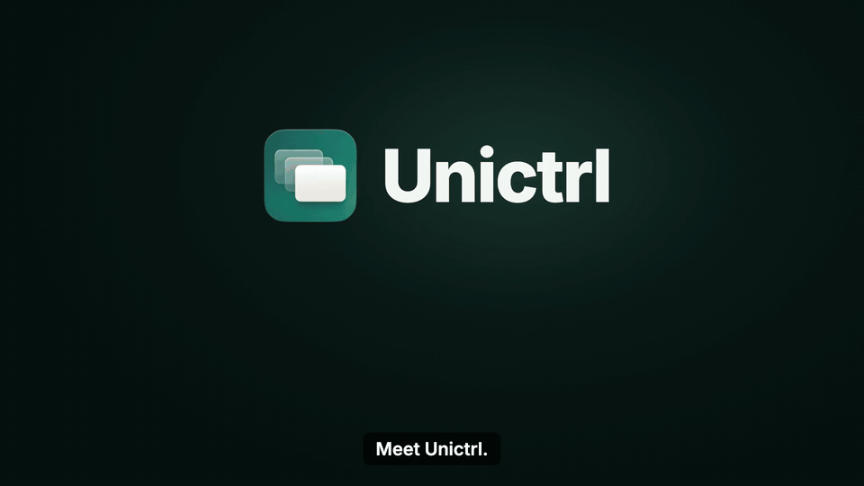

# Unictrl

[English](README.md) · **简体中文** · [繁體中文](README.zh-Hant.md)

**一套键盘，一只鼠标，所有电脑。**



▶ 观看 2 分钟介绍影片：[中文配音](https://github.com/enlivatech/unictrl-oss/releases/download/v0.1.0/unictrl-promo-zh-hans-dub.mp4) · [繁体中文字幕](https://github.com/enlivatech/unictrl-oss/releases/download/v0.1.0/unictrl-promo-zh-hant-sub.mp4) · [English](https://github.com/enlivatech/unictrl-oss/releases/download/v0.1.0/unictrl-promo-en.mp4)

把指针推出 Mac 屏幕的边缘，它就出现在 Windows 电脑上，键盘也跟着过去；推回来，就又回到 Mac。不用切换，不用等待。

键盘和鼠标一直连在 Mac 上，Unictrl 通过局域网把输入加密转发给 PC。用起来就像苹果的"通用控制"，只不过这次连接的是 Mac 和 Windows。两端都是原生应用：macOS 上是 SwiftUI 菜单栏应用，Windows 上是 WinUI 3 应用。

Unictrl 只做一件事：让你的指针和键盘在多台电脑之间通行。它不做剪贴板共享、文件传输或拖放。

- 源码：https://github.com/enlivatech/unictrl-oss
- 官网：[enliva.org](https://www.enliva.org)（Unictrl 出品方 Enliva）
- 许可证：[GPL-3.0](LICENSE)，免费开源

> **正式使用前请先读 [ADAPTING.md](ADAPTING.md)（英文）。** Unictrl 最初是为一张桌子写的工具：一台 Mac、一台 Windows 笔记本、罗技 MX Keys 键盘和 MX Anywhere 3S 鼠标。核心功能任何键盘鼠标都能用，但少数按键动作和罗技相关功能是按这套设备调的。ADAPTING.md 列出了每一处，以及怎么改。

## 功能

### 在电脑之间移动

- **推到屏幕边缘就过去。** 把指针推出 Mac 的左边缘或右边缘，就到了那一侧的 PC；推出 PC 的边缘就回来。切换只需几毫秒。
- **按真实尺寸排列屏幕。** 在设置 › Screens 里，把 PC 拖到 Mac 的左边或右边，也可以上下调整。屏幕按实际物理尺寸（读取每块显示器的毫米数）显示，即使两块屏幕分辨率不同，指针也会在你预期的高度穿过去。
- **Windows 原生手感。** 在 PC 上，指针使用 Windows 自己的速度和加速度，就像鼠标直接插在 PC 上。另有"PC 指针速度"滑块可以微调。
- **滚动一致。** 平滑滚动和反转滚轮方向（只针对鼠标滚轮，不影响触控板）在 Mac 上生效，也会带到 PC 上；PC 的滚动速度可以单独设置。
- **同一时刻只有一个指针。** 指针在 PC 上时 Mac 光标隐藏，在 Mac 上时 Windows 光标隐藏，一眼就知道指针在哪台电脑。
- **多台 PC**（实验性）。多台 PC 和 Mac 排成一行，指针可以从一台 PC 移到下一台。

### 键盘

- **整个键盘跟着指针走**，包括修饰键和按住连发。
- **Windows 上有两种键位。** "Windows layout"按键盘上的 Windows 标示（Option/⊞ 为 Win，Cmd/Alt 为 Alt）；"Mac layout"按位置对应（Option 为 Alt，Command 为 Win）。
- **媒体键和系统键**（音量、播放/暂停、下一首、静音）作用在指针所在的电脑上；亮度键调节 PC 笔记本内置屏幕的亮度。
- **大写锁定保持一致。** 穿越过去时，PC 会同步 Mac 的大写锁定状态。
- **锁定 PC**：按 Ctrl+Cmd+Q，和锁定 Mac 的快捷键一样。
- **听写键跟着指针走。** 用来启动听写的按键（鼠标中键、右侧 Command 键）会送到指针所在的电脑，不会被 Mac 截走。

### 配对与安全

- **用 6 位数配对码配对。** 在 Mac 上选择 *Pair a Windows PC…*，在 PC 上的 Unictrl 里输入 Mac 显示的配对码。配对码本身从不经过网络。
- **自动找到 Mac。** PC 会在局域网里自动发现 Mac，不用输入 IP 地址，Windows 上也不用添加入站防火墙规则。
- **始终加密。** 密钥通过 P-256 ECDH 交换生成，并用配对码确认；每条消息都用 AES-256-GCM 加密并防重放。没有不加密的模式。
- **无需账号，不经云端。** 所有数据都留在你的网络里，从不记录按键内容。

### 设置与状态

- **实时连接质量。** 两台电脑的设置里都会显示评级（Smooth、Some hitches、Choppy）、往返延迟和实时曲线、卡顿来自哪里（鼠标无线、Mac、网络还是 PC），以及不够流畅时可以尝试的改善清单。
- **自定义名称。** 可以给 Mac 和每台 PC 改名，名字会显示在所有界面上。
- **开机自动启动。** 两端默认登录时启动。Mac 应用可以显示在菜单栏和/或程序坞；Windows 应用可以显示在通知区域和/或任务栏。

### 可靠性

- **指针一定会回来。** PC 没有响应、连接中断或 Unictrl 退出时，指针都会回到 Mac。
- **不会卡键。** 指针离开或连接结束时，PC 会松开所有仍按着的键和鼠标按键。
- **短暂断线自动接上。** 连接很快恢复时，会接着刚才的状态继续。

### 罗技设备附加功能（可选）

适用于带 Easy-Switch 的罗技设备，例如 MX Keys：

- **只在一个 Easy-Switch 频道上共享。** 留一个频道给 Unictrl，其他频道照常直连单台电脑；键盘切到其他频道时，Unictrl 会自动暂停。
- **Mac 睡眠时把键盘鼠标交给 PC**，唤醒后再接回来。
- **就绪提示音。** 键盘和鼠标都回到共享频道时，可以播放一声提示音。

## 系统要求

- macOS 15 或更新版本（Apple 芯片或 Intel）。
- Windows 10 2004 或更新版本，或 Windows 11，x64。
- 两台电脑在同一个可信的局域网里（TCP 24860；UDP 24861 用于自动发现）。
- 构建需要：Mac 上的 Xcode 命令行工具（Swift 6）；Windows 上的 [.NET 10 SDK](https://dotnet.microsoft.com/download)。

## 安装

目前还没有签名的安装包，两端都需要从源码构建。

**macOS**

```sh
# 需要一个代码签名身份（Apple Development 证书即可）：
#   security find-identity -v -p codesigning
UNICTRL_SIGNING_IDENTITY=<证书哈希> macos/build-app.sh   # 安装到 ~/Applications/Unictrl.app
open ~/Applications/Unictrl.app
```

macOS 的辅助功能授权绑定在 bundle ID、安装路径和签名身份上，三者保持不变，重新构建后就不用重新授权。Fork 时建议把 `macos/Info.plist` 里的 bundle ID `com.enlivatech.unictrl` 改掉，避免和本应用共用授权和设置。

**Windows**（在 PC 上）

```powershell
dotnet publish windows\Unictrl\Unictrl.csproj -c Release -p:Platform=x64 -o out
# 把 out 复制到 %LOCALAPPDATA%\Programs\Unictrl，然后运行 Unictrl.exe
```

在 Mac 上开发、通过 SSH 在 PC 上构建：设置 `UNICTRL_WINDOWS_HOST=user@pc`，然后运行 `tools/deploy-windows.sh`（构建、安装并启动）或 `tools/test-windows.sh`（单元测试）。

**测试：** Mac 上 `cd macos && swift test`；Windows 上 `dotnet test windows\Unictrl.Tests`。

## 第一次使用

1. **Mac：** 在 系统设置 › 隐私与安全性 里，允许 Unictrl 使用"辅助功能"和"输入监控"。
2. **Mac：** 点菜单栏里的 Unictrl，选择 **Pair a Windows PC…**，屏幕上会显示 6 位数配对码。
3. **PC：** 打开 Unictrl，输入配对码。
4. **Mac：** 在设置 › **Screens** 里，把 PC 拖到它在桌上所在的那一侧。
5. 把指针推出那条边。

Windows 应用以管理员权限运行，这样在管理员窗口里也能打字。

## 工作原理

Mac 通过事件监听（event tap）读取输入。指针在 Mac 上时，Unictrl 只留意指针是否到达外侧边缘；一旦穿越，Mac 冻结并隐藏自己的光标，把每一次移动、点击、滚动和按键转发给 PC，由 PC 用 `SendInput` 重现。指针到达 PC 另一侧边缘时，PC 通知 Mac，指针就回来了。

由 PC 主动连接 Mac（TCP 24860），所以 Windows 不需要入站防火墙规则。完整的通信协议见 [docs/PROTOCOL.md](docs/PROTOCOL.md)，按键对应见 [docs/KEYMAP.md](docs/KEYMAP.md)（英文）。

## 常见问题

**和"通用控制"有什么不同？** 通用控制只在苹果设备之间使用。Unictrl 把同样的体验带到 Mac 和 Windows 之间；Mac 同时连着 iPad 时，两者可以一起用。

**和 Synergy、Barrier、Deskflow 有什么不同？** Unictrl 更小，两端都是原生应用：只有一个功能，一个 SwiftUI 应用加一个 WinUI 3 应用，始终加密，用配对码配对，内置 Windows 原生指针速度和屏幕物理尺寸。它是独立编写的代码，不是这些项目的分支。

**为什么不做剪贴板和文件传输？** 为了把一件事做好。剪贴板同步是另一个独立的产品。

**能不能让 Windows 当连接键盘鼠标的那台？** 目前不行，键盘鼠标始终连在 Mac 上。

**能通过互联网使用吗？** 它是为局域网设计的。Wi-Fi 延迟会表现为指针卡顿；任意一台电脑接网线会有帮助，连接质量的改善清单也会告诉你还能做什么。

**会把数据发到服务器吗？** 不会。Unictrl 只和你自己的电脑通信。

## 改造与参与贡献

[ADAPTING.md](ADAPTING.md)（英文）列出了哪些地方是按最初那套设备定制的（罗技设备、少数按键动作、实际测试过的设备组合、用到的 macOS 私有 API），以及怎么改。欢迎在 <https://github.com/enlivatech/unictrl-oss/issues> 提 issue 和 pull request，使用问题和想法可以发到 [Discussions](https://github.com/enlivatech/unictrl-oss/discussions)；这是一个小项目，不承诺提供支持。安全问题请按 [SECURITY.md](SECURITY.md) 私下报告。

## 许可证

代码和图标都以 [GNU GPL v3.0](LICENSE) 授权：可以自由使用、修改和分发；分发修改版时也必须以 GPL-3.0 开放源码。Fork 可以继续使用 Unictrl 这个名字和图标。

© 2026 Enliva LLC · [enliva.org](https://www.enliva.org)
